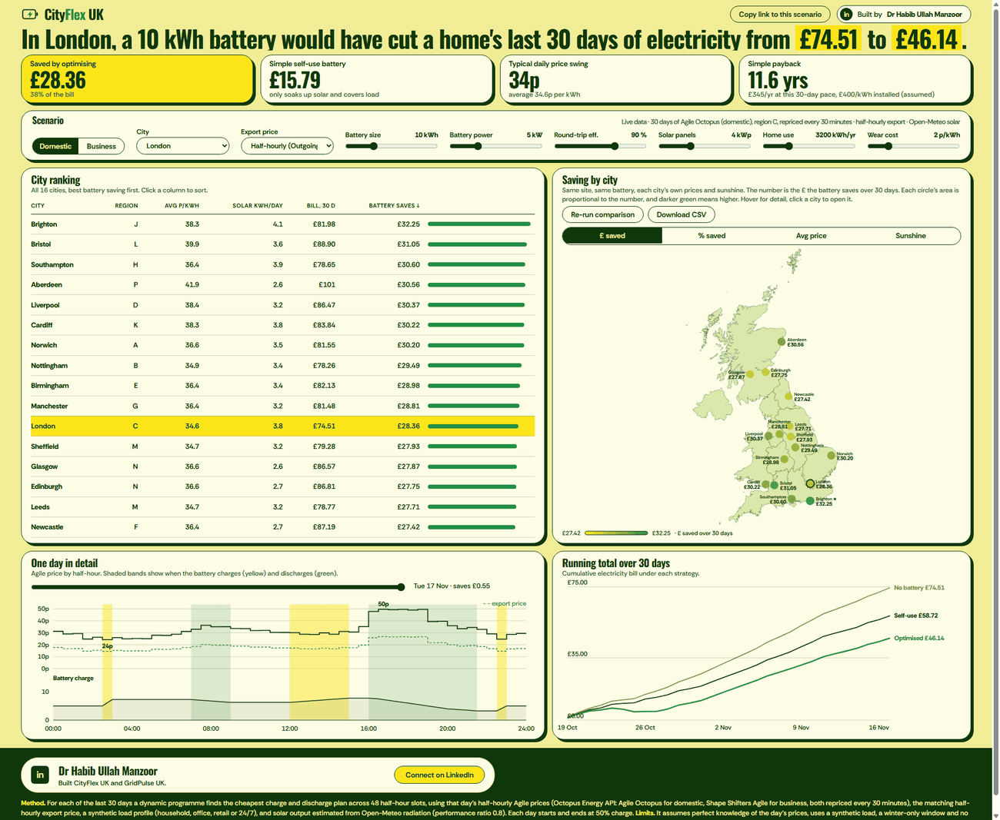

# CityFlex UK

What would a battery (and solar) save in your city? Pick one of 16 UK cities, choose **Domestic** or **Business**, and CityFlex pulls that city's regional **Octopus Energy** half-hourly prices and local **Open-Meteo** sunshine for the last 30 days. A dynamic-programming optimiser then finds the cheapest battery schedule for each day.

- No build step, no backend, no API keys. Static files, so it hosts free on GitHub Pages.
- **Domestic** uses Agile Octopus (inc VAT). **Business** uses Agile for business (ex VAT), which reprices every 30 minutes, with a site type (office, retail, 24/7) and weekday/weekend load.
- Export is either a flat rate or the half-hourly Agile Outgoing price.
- Compares three bills: no battery, self-use battery, price-optimised battery.
- **Saving by city** map: circle area and colour show the chosen metric (£ saved, % saved, average price, sunshine). Hover for detail, click a city to open it.
- A simple payback figure uses an assumed installed cost (£400/kWh domestic, £350/kWh business), clearly labelled as an assumption.
- **Copy link to this scenario** stores every setting in the URL, so a shared link opens the same case. **Download CSV** exports the city ranking.

## Run locally

    python -m http.server 8877      # then open http://localhost:8877
    node test.js                    # optimiser tests

## Files

- `optimiser.js`: the DP dispatch, load shapes and baselines (tested)
- `index.html`: UI, live data fetch, SVG charts and map
- `ukmap.js`: UK outline paths used by the map
- `test.js`: limits, energy balance, monotonicity, degradation, export-price and load-shape tests

## Limits (be honest in interviews)

- Perfect foresight of each day's prices. Agile is published the afternoon before, so this is close but optimistic.
- Synthetic load shapes, 30-day window (not seasonal), UTC day boundaries.
- No standing charges, network or demand charges. The payback figure scales the 30-day saving to a year, so treat it as indicative.
- The self-use baseline ignores prices, so with half-hourly export it can be worse than no battery.
- Planning estimate only, not financial advice.

## Deploy

Push to GitHub, then Settings > Pages > deploy from `main` / root.
